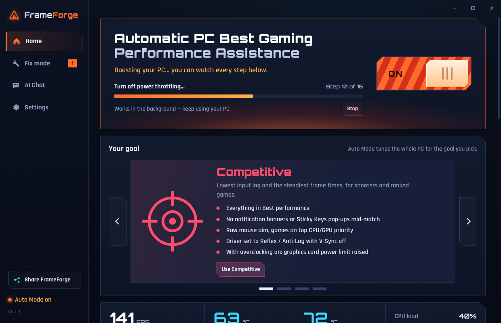
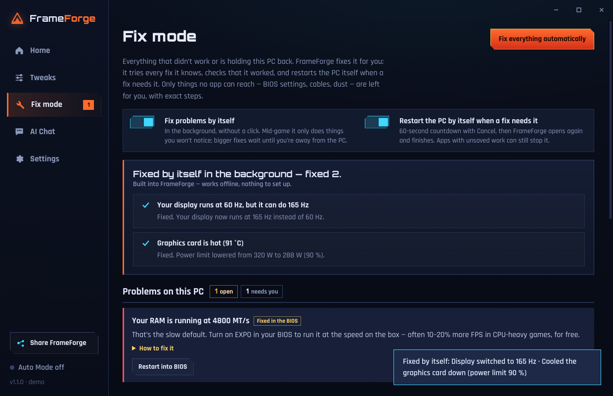

# FrameForge

**Automatic gaming performance for Windows 10/11 — AMD, NVIDIA and Intel.**
Made by TwicyTom.

### ⬇️ [Download the latest version](https://github.com/toer15/frameforge/releases/latest)
Click **FrameForge-Setup-x.x.x.exe** under *Assets*. Updates arrive inside the app after that.

---

## What it does

Pick a goal — **Competitive**, **Best performance**, **Balanced** or **Best graphics** — and flip
**Auto Mode** on. FrameForge scans your PC and applies only the tweaks that fit your hardware:

- Ultimate Performance power plan, Game Mode, game CPU/GPU priority
- Every Steam and Epic game set to run on your fastest graphics card
- Xbox background recording off, raw mouse aim, no pop-ups mid-match (Competitive)
- Chris Titus Tech's Windows Utility tweaks (Standard preset)
- A **Tweaks tab** with 28 switches — reduce input lag, use all CPU cores, keep USB awake, Nagle off and more — each explained, showing its real state, and fully undoable
- A driver checklist for AMD Software / the NVIDIA app made for your goal
- FPS counter with 1% lows, real CPU and GPU temperatures, in-game overlay (Ctrl+Shift+F)
- **Fix mode** with a built-in fixer: one click fixes what it can by itself (display refresh rate, reverted tweaks, failed steps, missing tools, full drive…) and gives step-by-step instructions for the rest, like the exact BIOS menu for XMP/EXPO on your motherboard
- **AI chat** that knows your PC and what was changed (needs your own Claude API key, or free Ollama)

Every change is listed with its exact before → after value, and **Undo all changes** puts your PC back.
FrameForge makes a Windows restore point before it changes anything.

## Installing

1. Run the installer. Windows will say **"Windows protected your PC"** because the app isn't
   code-signed yet — click **More info → Run anyway**.
2. Say **Yes** to the administrator prompt. Power plans, GPU scheduling and restore points need it.

## ⚠️ Beta

This is an early version. It has been tested in a sample setup but not yet on many real PCs.
If something goes wrong, use **Undo all changes**, or Windows System Restore with the restore point
"FrameForge - before optimizing". Chris Titus tweaks are undone with his tool's own Undo button
(Fix mode → Open Chris Titus tool).

For developers: see [DEVELOPING.md](DEVELOPING.md).

Found a bug? [Open an issue](https://github.com/toer15/frameforge/issues) or tell TwicyTom on Discord.
